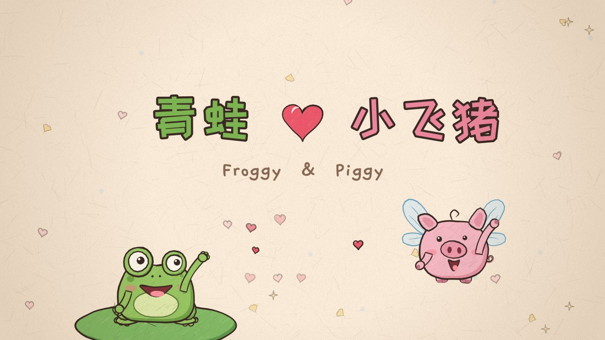

# 青蛙 ♥ 苍蝇猪 · Froggy & Piggy

一部约 4 分钟的手绘风格动画短片，有配乐和音效。

主演：一只丑萌的绿色青蛙，和一只长着透明小翅膀的丑萌小猪：苍蝇猪。



## 怎么看

- **直接看视频**：`froggy-and-piggy.mp4`（1920×1080，30fps，带音乐）。
- **在浏览器里放映**：用浏览器打开 `index.html`（`music.mp3` 要和它放在同一个目录）。
  可以暂停、拖动进度条、全屏，空格键播放 / 暂停。画面是实时绘制的，所以缩放到任何尺寸都清晰。

## 分镜

| 时间 | 场景 | 画面 |
| --- | --- | --- |
| 0:00 | 片头 | 手写标题「青蛙 ♥ 苍蝇猪」，青蛙从荷叶上探头，苍蝇猪扇着翅膀飞进来打招呼 |
| 0:07 | 校园相遇 | 秋天的校园，银杏叶飘落。青蛙抱着书、苍蝇猪边飞边看手机，两人撞在一起，书散了一地；苍蝇猪捡起书递给青蛙，手碰到的一瞬间，画面变成粉色，“扑通扑通” |
| 0:22 | 互发消息 | 分屏的两个房间，消息气泡在两部手机之间飞来飞去，从一条一条到越来越密，窗外从白天聊到夜里 |
| 0:36 | 两个环球影城 | 分屏：同一天，两人在两个不同的环球影城玩，同时自拍，照片在空中交叉飞向对方：“好巧！”“哈哈哈！” |
| 0:48 | 晚安 | 苍蝇猪在被窝里发出“晚安”，消息化作流星划过夜空飞进青蛙的窗户；两人都开心地睡着了 |
| 1:00 | 青蛙的梦 | 梦里的云上楼梯：苍蝇猪站在青蛙上方，转身比心，一颗大爱心飘下来落进青蛙怀里 |
| 1:12 | 10/19 | 苍蝇猪发来长长的告白（用波浪线代表文字），最后一句是 **yes or no**；青蛙的心越跳越快，然后激动得蹦了起来 |
| 1:26 | 10/20 | 日历翻到 10/20，青蛙回复 “YES !!!”，苍蝇猪飞过来抱住青蛙，爱心和彩纸飞满画面 |
| 1:38 | 快剪 | 密室逃脱（青蛙吓得发抖）· 游山玩水，给苍蝇猪分享照片 · 7/4 苍蝇猪生日，一起看恐怖片 · 海洋公园 · 羽毛球 · 哈利波特快闪 |
| 2:19 | 时光流逝 | 一棵树下，春夏秋冬轮转，日历一页页飞走 |
| 2:26 | 石膏画 | 青蛙戴着贝雷帽给石膏浮雕上色（画的是他们俩），苍蝇猪看到后两眼冒爱心，抱着不撒手 |
| 2:36 | 马卡龙 & 回转寿司 | 一起吃马卡龙；回转寿司的盘子越叠越高 |
| 2:45 | 看电影 | 黑暗的影院里，青蛙慢慢把头靠在苍蝇猪肩上 |
| 2:55 | 打游戏 | 背影坐在沙发上打像素游戏，赢了之后击掌 |
| 3:02 | 河边散步 | 黄昏的河边，手牵手慢慢走 |
| 3:12 | 地下 | 镜头快速下移，穿过泥土和石头，来到地下 |
| 3:16 | 爱心 | 一颗红色的爱心几次出现裂痕、甚至差点裂成两半，每次都被淡蓝色的胶布贴好；最后胶布一圈圈缠满，整颗心变成淡蓝色，闪闪发光 |
| 3:40 | 回到地面 | 镜头升回地面，日历飞快翻页，又一次停在 10/20 |
| 3:46 | 分叉的路 | 黎明的路在远处像树枝一样分叉，青蛙和苍蝇猪手牵手，始终一起向前走，天上浮现一颗爱心 |
| 4:03 | 结尾 | 淡蓝色的心，「未完待续…」 |

描述里没写细的地方（衔接、表现方式）是我自己补的，比如：用分屏表现“同时”、晚安消息变成流星、
告白内容用波浪线代替、结尾的「未完待续」。

## 手绘风格是怎么做的

全部用 Canvas 2D 代码画出来，没有用任何图片素材（`js/sketch.js`）：

- **会“呼吸”的线条**：每条轮廓线都沿着噪声轻微抖动，并且每秒换 8 次随机种子，像传统手绘动画逐张重画时线条的微微晃动（line boil）。
- **毛笔一样的线**：线条是粗细不均、两头收笔的填充多边形，闭合图形的结尾会故意多画一小段交叠。
- **蜡笔质感**：上色区域叠一层斜向蜡笔纹理，填色和描线有一点点错位。
- **纸张**：最后整幅画面乘上一张带纤维和暗角的纸张纹理。

## 音乐

配乐也是代码“演奏”的（`js/music.js`），用 Web Audio 合成了尤克里里感的拨弦、八音盒 / 钟琴、柔和的铺底、钢琴、轻打击乐，
以及各种音效（消息气泡、相机快门、碰撞、心跳、裂开、撕胶带……）。整部片子是 100 BPM、F 大调，主旋律在片头、聊天、
在一起、分叉的路上反复出现；地下爱心那段转到 A 小调钢琴，缠满胶带的那一刻回到明亮的 F 大调。

音效和画面共用 `js/timeline.js` 里的时间点，所以每一次碰撞、翻页、贴胶带都和画面对得上。

## 重新渲染

需要 Node.js、[Playwright](https://playwright.dev/)（Chromium）和 ffmpeg。

```bash
npm install                      # 安装 playwright
node tools/render.js audio       # 合成配乐 → music.wav / music.mp3
node tools/render.js video       # 逐帧渲染 → froggy-and-piggy.mp4
# 可选参数：--width 1280 --fps 30 --crf 23 --from 60 --to 90 --out clip.mp4
```

## 文件

```
index.html          放映页面
music.mp3           配乐（由 tools/render.js audio 生成）
froggy-and-piggy.mp4
js/
  sketch.js         手绘渲染引擎
  chars.js          青蛙、苍蝇猪
  props.js          道具与小特效
  timeline.js       场景时长与关键时间点（画面和音乐共用）
  scenes1.js        片头 → 10/20
  scenes2.js        快剪
  scenes3.js        时光流逝 → 结尾
  film.js           场景切换与转场
  player.js         播放器
  music.js          配乐与音效
tools/render.js     离线渲染音频 / 视频
```
