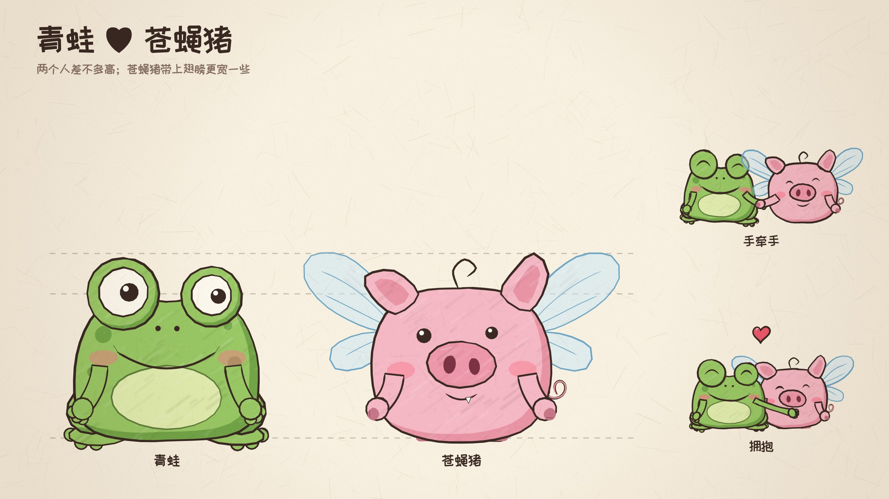

# 角色素材 · 青蛙 & 苍蝇猪

把短片里的两位主角单独导出来，方便以后用**同样的形象**做新视频。
所有图片都由影片本身的绘制代码（`js/chars.js`）直接画出来，和影片里一模一样，不是重新描的。



## 里面有什么

| 目录 | 内容 | 用途 |
| --- | --- | --- |
| `refs/` | 干净的单人 / 双人参考图（纸色背景、无文字，`.jpg`） | 上传给 AI 视频工具当角色参考图、图生视频的首帧 |
| `sheets/` | 角色设定图：`frog.jpg`、`pig.jpg`（正面 + 背面 + 12 个表情 + 色板）、`poses.jpg`（全部动作）、`together.jpg`（两人比例、牵手、拥抱） | 给人看的“角色说明书”；也可以作为多视角参考图 |
| `png/frog/`、`png/pig/` | 透明背景 PNG，1200×960：12 个动作 + 12～13 个表情（`face-*.png`） | 剪辑软件里直接叠到背景上；做表情包；当 AI 参考图 |
| `png/duo/` | 两人同框透明 PNG，2400×960：并排、手牵手、拥抱、背影 | 同上 |
| `loops/` | 首尾无缝的循环动画：`.webm`（**带透明通道**）、`.mp4` 和 `.gif`（纸色背景） | 剪辑时直接拖进时间线循环播放；给 AI 当动作参考 |
| `manifest.json` | 文件清单、色板、画框尺寸和锚点 | 写程序批量使用时读取 |
| `studio.html` | 角色工作台：在浏览器里选表情、手臂、飞 / 走 / 背面…，下载任意组合的透明 PNG | 需要清单里没有的新姿势时用 |

**对齐**：同一类 PNG 尺寸相同，角色脚下中心永远在同一个像素点（单人图 `(600, 860)`，双人图 `(1200, 860)`，见 `manifest.json` 里的 `anchor`），
所以在剪辑软件里换表情 / 换动作时，角色不会跳位置。循环动画也是同样的画框（单人 900×720，脚下在 `(450, 645)`）。

### 动作

青蛙：正面、背面、走路、打招呼、欢呼、蹦起来、比心、抱抱、叉腰、看手机、吓得发抖、贝雷帽
苍蝇猪：正面、背面、飞、走路、打招呼、欢呼、蹦起来、比心、抱抱、叉腰、看手机、背面飞

### 表情

微笑、害羞、开心、兴奋、大喊、心动（爱心眼）、惊讶、害怕、难过、哭（只有青蛙）、睡着、无语、亲亲

### 循环动画

| 文件 | 内容 | 时长 |
| --- | --- | --- |
| `frog-idle` | 青蛙待机，中间眨一次眼 | 2.0 秒 |
| `frog-walk` | 青蛙走路（原地） | 2.1 秒 |
| `frog-wave` | 青蛙挥手 | 3.1 秒 |
| `frog-cheer` | 青蛙欢呼蹦跳 | 3.1 秒 |
| `pig-idle` | 苍蝇猪待机，翅膀轻轻扇、眨眼 | 2.1 秒 |
| `pig-fly` | 苍蝇猪嗡嗡地飞，上下浮动 | 6.3 秒 |
| `pig-walk` | 苍蝇猪走路（原地） | 2.1 秒 |
| `pig-wave` | 苍蝇猪边飞边挥手 | 6.3 秒 |
| `duo-walk` | 两人手牵手散步（原地） | 2.1 秒 |
| `duo-walk-away` | 背影，手牵手往前走 | 2.1 秒 |

时长取的是走路相位、扇翅膀、上下浮动、挥手这些周期的公倍数，所以首尾完全接得上。
轮廓线每秒“抖”8 次（手绘的 line boil），和影片一致。

---

## 角色设定

整体画风：**手绘蜡笔风的 2D 卡通，“丑萌”**。深棕色墨线（`#3b2a24`，不是纯黑），线条粗细不均、两头收笔，闭合处有一点交叠；
上色有斜向的蜡笔纹理，颜色和线条轻微错位；背景是暖白色的纸（`#fbf5e8`），带纤维和暗角。
角色基本都是正面、平面的，没有透视；两个角色差不多高，矮矮胖胖，没有脖子。

### 青蛙

- 草绿色（`#9ccc68`）、矮墩墩的梨形身体，下宽上略窄，深绿（`#74a84a`）阴影在右下
- 奶油黄绿色（`#e4f1b4`）的大椭圆肚皮
- 头顶两只凸起的圆眼睛：白眼球、黑瞳孔带白色小高光；**左眼大、右眼小，两只眼睛看的方向略不一样**（“丑萌”的关键）
- 超宽的弧形笑嘴，**两个嘴角各有一道小短线**；两个小点鼻孔
- 两颊粉色椭圆腮红（激动时腮红上会出现三道斜线）
- 身体两侧有几块深绿色圆斑
- 细细的手臂，手是三颗小圆球指头；圆鼓鼓的大腿，扁扁的脚掌带三个圆脚趾、向外撇
- 没穿衣服；画画时会戴一顶红色贝雷帽（`#e8605f`）

### 苍蝇猪

- 粉色（`#f8bccb`）圆滚滚、近似圆形的身体，深粉（`#ec97ab`）阴影
- 两只尖尖的三角耳朵向外翘，耳朵里是深粉色；**右耳比左耳高一点**
- 头顶一根卷卷的呆毛
- **很大的椭圆猪鼻子**（`#f19bb0`），两个深酒红色鼻孔（`#7d3445`），鼻子左上有一道白色高光
- 小豆豆眼（黑点 + 白高光），一大一小
- 小小的微笑嘴，**嘴角露出一颗白色小虎牙**
- 粉色腮红
- **背上一对透明淡蓝色的苍蝇翅膀**：上翅大、下翅小，淡蓝描边（`#6fa9cc`），有几条翅脉和一道白色高光；平时轻轻扇，飞的时候扇得飞快，身体上下浮动
- 身体右后侧一根螺旋小尾巴
- 短粗的圆手臂，手是带蹄子（`#c9798c`）的小圆球；两条短粗的方腿，蹄子同色

### 两个人在一起

- 身高几乎一样（青蛙到眼睛顶 ≈ 苍蝇猪到耳朵尖）；苍蝇猪算上翅膀更宽
- 习惯站位：青蛙在左，苍蝇猪在右；牵手时青蛙用右手、苍蝇猪用左手
- 拥抱时苍蝇猪从右边贴过来，两人都眯着眼笑、腮红很重

---

## 用 AI 视频工具生成新视频

1. 上传参考图：单人用 `refs/frog.jpg` / `refs/pig.jpg`，两人同框用 `refs/frog-and-pig.jpg`；
   工具支持多张参考图时，再加上 `refs/*-back.jpg`（背面）或 `png/` 里对应动作的图。
2. 图生视频时，可以先用 `png/` 里的透明图叠到自己的背景上做成首帧。
3. 提示词里把关键特征写清楚，下面这段可以直接复制，再接上你想要的场景和动作。

**英文提示词（多数视频模型对英文更稳定）**

```text
Hand-drawn 2D cartoon in a crayon-and-ink storybook style, "ugly-cute". Wobbly dark-brown ink outlines
(#3b2a24, not black) of uneven thickness with tapered ends, slight line boil; flat colors with diagonal
crayon texture slightly offset from the lines; warm off-white paper background (#fbf5e8) with subtle fibers
and vignette. Flat front-facing characters, no perspective, no 3D shading.

Character 1 — Froggy: a short, chubby, pear-shaped light green frog (#9ccc68) with a big pale yellow-green
oval belly, a few darker green spots on the sides, two bulging round eyes on top of the head (left eye
bigger than the right, pupils looking in slightly different directions), a very wide curved smile with a
tiny tick mark at each corner, two dot nostrils, pink oval blush, thin arms with three round finger-tips,
flat splayed feet with three round toes. No clothes.

Character 2 — Piggy (the "fly-pig"): a round, chubby pink pig (#f8bccb) about the same height as Froggy,
pointy triangular ears (right ear a bit higher), one curly hair on top, tiny black bean eyes of slightly
different sizes, a huge oval snout (#f19bb0) with two dark red nostrils, a small smile with one tiny white
fang, pink blush, stubby arms with little hooves, two short square legs, a spiral tail, and a pair of
transparent pale-blue fly wings with thin blue veins on its back that buzz fast when it flies.
```

**中文提示词**

```text
手绘蜡笔风的 2D 卡通，丑萌。深棕色（不是纯黑）手绘墨线，粗细不均、两头收笔、线条轻微抖动；平涂上色带斜向蜡笔纹理，
颜色和线条略有错位；暖白色纸张背景，带纤维纹理和暗角。角色正面平面，无透视、无立体光影。
角色一「青蛙」：矮胖梨形的草绿色青蛙，奶油黄绿色大肚皮，身体两侧有深绿斑点；头顶两只凸起的圆眼睛，左大右小、
两只瞳孔看向略不同的方向；超宽的弧形笑嘴，两个嘴角各有一道小短线；两个小点鼻孔；粉色腮红；细手臂，三根圆指头；
扁平外撇的脚掌带三个圆脚趾；不穿衣服。
角色二「苍蝇猪」：和青蛙差不多高的圆滚滚粉色小猪，三角尖耳朵（右耳略高），头顶一根卷呆毛，一大一小的黑豆豆眼，
很大的椭圆猪鼻子和两个深红鼻孔，小微笑嘴露出一颗白色小虎牙，粉色腮红，短粗手臂带小蹄子，两条短方腿，螺旋小尾巴，
背上一对透明淡蓝色、带蓝色翅脉的苍蝇翅膀，飞的时候嗡嗡快速扇动。
```

## 用代码做新视频（和这部短片一样的做法）

角色就是两个函数，在任何 Canvas 2D 上都能画，可以写新的场景直接复用：

```html
<script src="js/sketch.js"></script>
<script src="js/chars.js"></script>
<script src="js/props.js"></script>   <!-- 可选：爱心、手机、星星等小道具 -->
```

```js
SK.beginFrame(t);                 // 每帧先调用（决定线条抖动）
CH.frog(ctx, x, y, scale, opts);  // (x, y) 是脚下中心，scale = 1 时高约 125 像素
CH.pig(ctx, x, y, scale, opts);
```

`opts` 里常用的选项：

| 选项 | 说明 |
| --- | --- |
| `t` | 时间（秒），驱动眨眼、挥手、扇翅膀 |
| `face` | `smile` `happy` `open` `grin` `yell` `love` `o` `scared` `sad` `cry` `sleep` `kiss` `flat` |
| `arms` | `down` `up` `front` `phone` `hip` `wave` `cheer` `hug` `heart`，或 `{ l, r }` 分别指定，或直接给手的坐标 `[x, y]` |
| `look` | 眼睛看向 `[x, y]`，范围 -1～1 |
| `blush` | 腮红 0～1.4（> 0.8 出现斜线） |
| `walk` | 走路相位（弧度），逐帧递增就是走路 |
| `fly` | 苍蝇猪：飞（快速扇翅膀 + 上下浮动） |
| `back` / `backArm` | 背面 / 背面时手的位置 |
| `flip` | 左右翻转 |
| `hop` `squash` `tilt` `shiver` | 跳起高度、压扁拉长、倾斜、发抖 |
| `sweat` `brows: 'worried'` `tears` | 汗珠、皱眉（青蛙）、眼泪（青蛙） |
| `hold` `holdL` `holdR` `acc` | 手里拿的东西 / 配件（函数，在手或身体的坐标系里画） |
| `blink: false` | 关掉自动眨眼 |

`characters/studio.js` 里有每个导出姿势用的具体参数，可以照抄。

## 重新导出

需要 Node.js、Playwright（Chromium）和 ffmpeg（同 `tools/render.js`）。

```bash
node tools/export-characters.js                      # 全部重新导出
node tools/export-characters.js --only png,refs      # 只导出某几类：png / refs / sheets / loops
node tools/export-characters.js --only loops --fps 30 --keep-frames   # 循环动画另存透明 PNG 序列到 loops/frames/
```

想加新的动作、表情或循环动画，在 `characters/studio.js` 的 `POSES` / `EXPRESSIONS` / `DUO` / `LOOPS` 里加一项再导出就行。
